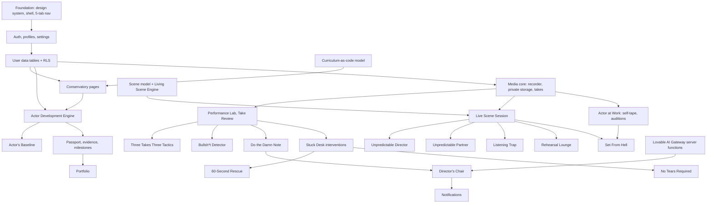

# 07 — Feature Dependency Map

## Critical path

Foundation → Auth/DB → Curriculum model → Development Engine → Media core → Living Scene Engine. Everything else hangs off these six.

## External dependencies

| Dependency | Needed by | Fallback |
| --- | --- | --- |
| Lovable Cloud | Everything with user data | None — required from Phase 1 |
| Browser camera/mic (MediaRecorder) | Takes, self-tape, interventions | Text reflection evidence; clear unsupported-device message |
| Lovable AI Gateway | Director's Chair AI notes, optional note generation | Curated note banks and coach review |
| Text-to-speech (optional) | Unpredictable Partner voiced lines | On-screen partner lines |
| Qualified practitioner review | Curriculum content (Phase 9) | Content stays `beta` until reviewed |
| Capacitor | Native packaging | PWA |
